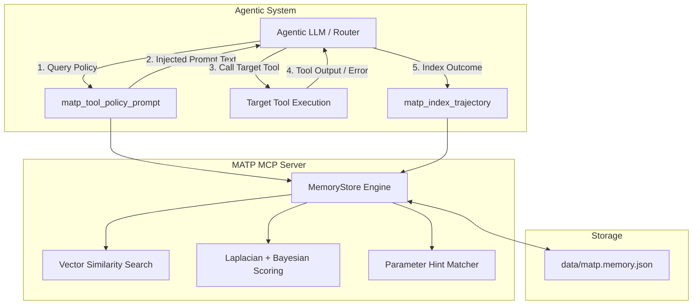

# MATP MCP — Memory-Augmented Tool Policy Learning

[](https://nodejs.org/)
[](https://www.typescriptlang.org/)
[](https://modelcontextprotocol.io/)
[](LICENSE)

An official **Model Context Protocol (MCP)** server that turns historical `(Sub-goal, Tool, Parameters, Status)` execution trajectories into a **dynamically ranked Tool Recommendation Matrix** and **parameter auto-correction hints**.

It resolves the classic long-horizon agent failure: repeated sub-optimal tool selections and invalid parameter payloads caused by relying solely on static system prompt instructions.

---

## Table of Contents

- [Overview](#overview)
- [Architecture & Workflow](#architecture--workflow)
- [Core Features](#core-features)
- [Complete Tool Reference](#complete-tool-reference)
- [Quick Start](#quick-start)
- [Configuration](#configuration)
- [Verification & Testing](#verification--testing)
- [Client & Host Integration](#client--host-integration)
  - [1. Official MCP Inspector (Free Web UI)](#1-official-mcp-inspector-free-web-ui)
  - [2. Free Open-Source IDE Extensions (Cline / Roo Code / Continue)](#2-free-open-source-ide-extensions-cline--roo-code--continue)
  - [3. Claude Desktop (Optional)](#3-claude-desktop-optional)
- [Project Structure](#project-structure)
- [Roadmap & Scaling](#roadmap--scaling)
- [License](#license)

---

## Overview

In multi-step LLM agent systems:
1. **Predictive Context Router**: Calls `matp_tool_policy_prompt` before the agent selects a tool. It receives historical win-rates, optimal parameter shapes, and failure warnings relevant to the current sub-goal.
2. **Background Synthesis Engine**: Calls `matp_index_trajectory` after every tool execution to record the outcome into the Semantic Memory Buffer.
3. **Self-Healing Loop**: If an error pattern repeats, `matp_learn_correction` registers a schema fix hint which is auto-injected in future similar contexts before the tool is even called.

---

## Architecture & Workflow



---

## Core Features

- **Zero-Dependency Local Embeddings by Default**: Uses an offline, deterministic n-gram hashing embedder (384-dimensional). No network access, API keys, or GPU needed.
- **Pluggable Vector Backends**: Switch effortlessly between `local` (offline), `ollama` (free local embeddings with `nomic-embed-text`), or `openai` (`text-embedding-3-small`) using simple environment variables.
- **Laplacian & Bayesian Confidence Smoothing**: Prevents overconfidence on small sample sets (e.g. 1/1 success won't naively outrank 95/100 successes).
- **Atomic File Persistence**: Thread-safe, crash-resilient file writes with `.tmp` staging to prevent corruption.
- **O(1) Rule Retrieval**: Indexed map lookups for fast retrieval during hot execution paths.
- **Built-in Verification Suite**: Complete end-to-end test client using the official `@modelcontextprotocol/sdk` client.

---

## Complete Tool Reference

The server exposes **11 MCP tools** over `stdio`:

### Policy & Recommendation

| Tool Name | Description | Key Arguments |
|-----------|-------------|---------------|
| `matp_tool_policy_prompt` | Pre-fetches ranked tool recommendations and parameter correction hints formatted as system-prompt text. | `subGoal` (string), `candidateTools` (string[], optional), `topK` (number, default: 12) |
| `matp_recommend_tools` | Returns raw JSON payload of ranked tool candidates, confidence scores, success rates, and sample parameters. | `subGoal` (string), `candidateTools` (string[], optional), `topK` (number, default: 12) |
| `matp_parameter_hints` | Recalls specific schema/formatting hints for a tool from past terminal or API error outputs. | `tool` (string), `context` (string, optional), `topK` (number, default: 3) |

### Learning & Indexing

| Tool Name | Description | Key Arguments |
|-----------|-------------|---------------|
| `matp_index_trajectory` | Indexes an execution tuple `(subGoal, tool, parameters, status)` into the memory buffer. | `subGoal` (string), `tool` (string), `parameters` (object), `status` (`success`\|`failed`\|`partial`), `outputSummary` (string, optional) |
| `matp_learn_correction` | Teaches the buffer a reusable parameter formatting rule based on an observed error pattern. | `tool` (string, or `'*'`), `errorPattern` (string), `hint` (string) |

### Buffer Management & Telemetry

| Tool Name | Description | Key Arguments |
|-----------|-------------|---------------|
| `matp_list_trajectories` | Lists stored trajectories with optional filtering by tool or status. Returns newest first. | `tool` (string, optional), `status` (string, optional), `limit` (number, default: 50) |
| `matp_delete_trajectory` | Permanently deletes a single trajectory from the memory buffer by its UUID. | `id` (UUID string) |
| `matp_purge_old` | Prunes trajectories older than a specified number of days. | `maxAgeDays` (number) |
| `matp_list_corrections` | Lists learned correction rules, optionally filtered by tool. | `tool` (string, optional), `enabledOnly` (boolean, default: true) |
| `matp_disable_correction`| Soft-deletes (disables) a correction rule so it is no longer injected into prompts. | `id` (UUID string) |
| `matp_stats` | Returns buffer telemetry: trajectory count, active rules, status distribution, and storage path. | *None* |

---

## Quick Start

### 1. Prerequisites
- **Node.js**: `>= 20.0.0`
- **npm**: `>= 9.0.0`

### 2. Install & Build
```bash
# Clone and enter directory
cd matp-mcp

# Install dependencies
npm install

# Compile TypeScript
npm run build
```

### 3. Run the Server
```bash
npm start
# or directly:
node dist/index.js
```
The server will start and wait for standard JSON-RPC MCP requests over `stdio`.

---

## Configuration

Copy `.env.example` to `.env` to customize settings. Defaults are completely zero-config and require no external services:

```ini
# Embedding backend: "local" (default) | "ollama" | "openai"
EMBED_BACKEND=local

# Storage directory for the Semantic Memory Buffer (defaults to ./data)
MATP_DATA_DIR=./data

# (Optional) Ollama configuration:
# EMBED_BACKEND=ollama
# OLLAMA_BASE_URL=http://localhost:11434
# OLLAMA_EMBED_MODEL=nomic-embed-text

# (Optional) OpenAI configuration:
# EMBED_BACKEND=openai
# OPENAI_API_KEY=sk-...
# OPENAI_BASE_URL=https://api.openai.com/v1
# OPENAI_EMBED_MODEL=text-embedding-3-small
```

---

## Verification & Testing

The project includes multiple verification layers that run completely offline without external credentials:

```bash
# 1. Run all checks (Build + Smoke Test + Client Test)
npm run verify

# 2. Run official SDK Client test suite (simulates an MCP client connecting via stdio)
npm run test:client

# 3. Run isolated core policy smoke test
npm run smoke

# 4. Type check without compiling
npm run typecheck

# 5. Incremental compilation in watch mode (for development)
npm run watch
```

---

## Client & Host Integration

### 1. Official MCP Inspector (Free Web UI)
Test and debug your server interactively in your browser:
```bash
npx @modelcontextprotocol/inspector node dist/index.js
```
This opens a local web UI where you can inspect all 11 tool schemas and execute requests interactively.

### 2. Free Open-Source IDE Extensions (Cline / Roo Code / Continue)
You can use this MCP server with free local models via [Ollama](https://ollama.ai) (e.g. `llama3.2`, `qwen2.5-coder`) inside VS Code or VSCodium using extensions like **Cline** or **Roo Code**.

Add the following to your extension's MCP configuration file (e.g. `cline_mcp_settings.json`):
```json
{
  "mcpServers": {
    "matp": {
      "command": "node",
      "args": ["/absolute/path/to/matp-mcp/dist/index.js"]
    }
  }
}
```

### 3. Claude Desktop (Optional)
If using Claude Desktop, add to `~/Library/Application Support/Claude/claude_desktop_config.json`:
```json
{
  "mcpServers": {
    "matp": {
      "command": "node",
      "args": ["/absolute/path/to/matp-mcp/dist/index.js"]
    }
  }
}
```

---

## Project Structure

```
matp-mcp/
├── .env.example           # Environment template with backend documentation
├── .gitignore             # Ignore rules (node_modules, dist, data, etc.)
├── package.json           # Dependencies, bin link, and test scripts
├── tsconfig.json          # TypeScript compiler configuration (incremental build)
├── data/                  # Persistent storage directory (matp.memory.json)
├── dist/                  # Compiled JavaScript and TypeScript declarations
└── src/
    ├── index.ts           # MCP Server entry point with stdio transport & signal handling
    ├── smoke.ts           # Standalone smoke test (no MCP client required)
    ├── test-client.ts     # Full automated MCP client verification suite
    ├── core/
    │   ├── embed.ts       # Pluggable vector embedding engine (Local, Ollama, OpenAI)
    │   └── policy.ts      # MATP ranking, Laplacian smoothing, and prompt rendering
    ├── memory/
    │   └── memory.ts      # Persistent vector memory store with atomic JSON writes
    └── tools/
        └── indexTools.ts  # Zod schema definitions and MCP tool registration
```

---

## Roadmap & Scaling

- [x] Full MCP v1.30.0 specification compatibility.
- [x] O(1) hash map indexing for rule counters.
- [x] Native graceful shutdown with process signal handlers (`SIGINT`/`SIGTERM`).
- [x] Automated client verification suite (`test-client.ts`).
- [ ] SQLite-vec storage adapter for multi-million trajectory datasets.
- [ ] Direct export of synthesized tool-use fine-tuning datasets (DPO/RLHF).

---

## License

This project is licensed under the [MIT License](LICENSE).
